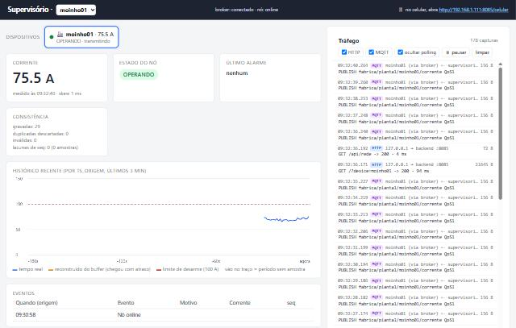
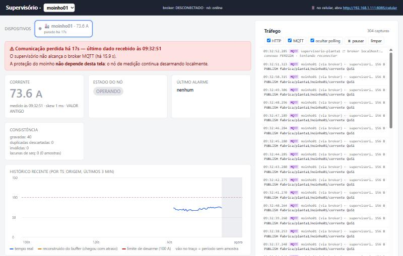
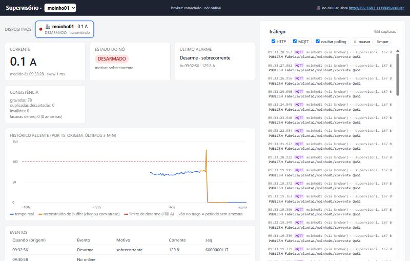
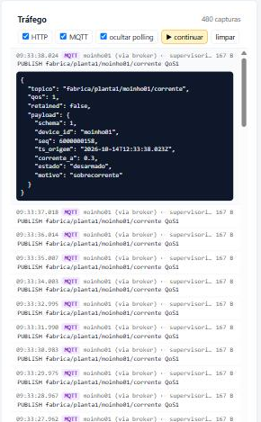
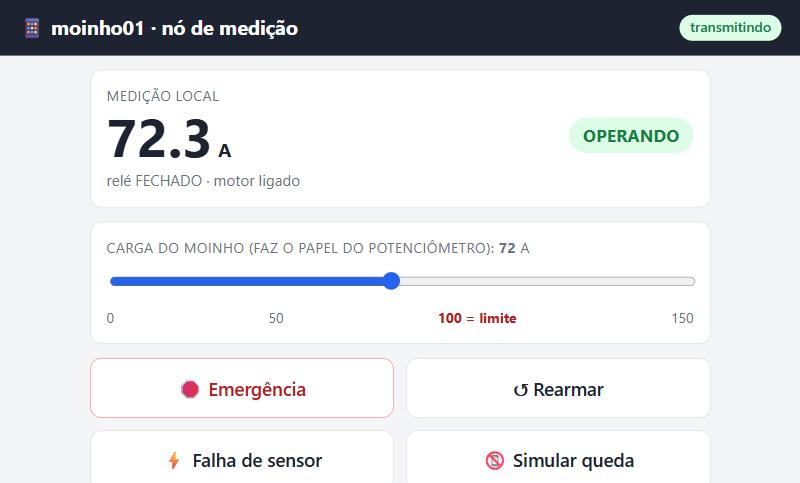
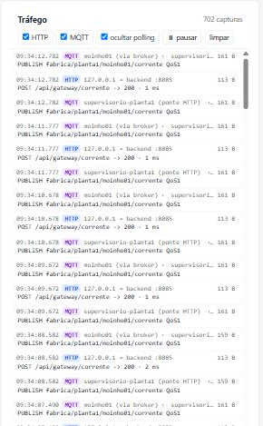

# Evidências

Evidência de que o dado foi **enviado** (log do simulador), **recebido** (log do backend
e banco) e **usado** (dashboard), em operação normal e com falha de comunicação.

## Evidência registrada (14/10/2026)

### Teste de falha automatizado — 14 de 14 verificações aprovadas

`scripts/teste_falha_local.ps1` (Windows, sem Docker) — broker derrubado por 32 s.
Resultado completo, logs do nó, do supervisório e do broker e os JSON de cada etapa em
[evidencias/teste-falha-local-2026-10-14/](evidencias/teste-falha-local-2026-10-14/)
(comece por `resultado.txt`).

### Prints

| # | O que mostra | Arquivo |
|---|---|---|
| 1 | Operação normal: corrente atual, OPERANDO, broker conectado, gráfico em azul, painel de tráfego recebendo uma mensagem MQTT por segundo |  |
| 2 | **Broker fora:** banner "Comunicação perdida há 17s — último dado recebido às 09:32:51", causa ("não alcança o broker"), valores em cinza com "VALOR ANTIGO", faixa "sem dados", painel com "conexão PERDIDA". No mesmo momento o simulador desarmou sozinho ("SEM REDE") |  |
| 3 | **Volta:** histórico reconstruído (trecho laranja = veio do buffer), pico de 129,8 A, DESARMADO/sobrecorrente, desarme nos eventos às **09:32:56** (horário real, chegou às 09:33:19), lacunas 0 |  |
| 4 | Painel de tráfego com uma mensagem aberta: tópico, QoS 1, payload com `seq` e `ts_origem` |  |
| 5 | Celular fazendo o papel do moinho01 (página `/celular`) |  |
| 6 | Caminho de cada leitura do celular: `POST /api/gateway/corrente` (HTTP) → `PUBLISH` da ponte no broker → `PUBLISH` entregue ao assinante (MQTT) |  |

Log do simulador no momento do print 2 (proteção atuando sem rede):

```
09:32:56 [PROTECAO] estado=desarmado motivo=sobrecorrente corrente=129.8 A rele=ABERTO (decidido localmente, SEM REDE)
09:32:57 [PROTECAO] sem broker ha 5s - protecao local ATIVA: estado=desarmado corrente=0.1 A | buffer 7/300 descartadas=0
09:33:02 [PROTECAO] sem broker ha 10s - protecao local ATIVA: estado=desarmado corrente=0.3 A | buffer 12/300 descartadas=0
09:33:19 [MQTT] conectado ao broker (ficou fora 26.8s); buffer com 29 mensagens para reenviar
09:33:19 [BUFFER] flush: 29 mensagens reenviadas com ts_origem/seq originais (restam 0)
```

> Os prints e o teste foram feitos com o broker MQTT em Python (amqtt), porque a máquina
> não tinha Docker. Com Docker, o `scripts/teste_falha.sh` faz o mesmo roteiro com o
> Mosquitto.

## Como gerar

Com Docker:

```bash
./scripts/teste_falha.sh
```

Sem Docker (Windows):

```powershell
powershell -ExecutionPolicy Bypass -File scripts	este_falha_local.ps1
```

O script leva cerca de 1 min 30 s. Deixe <http://localhost:8085> aberto num navegador ao
lado do terminal: quando aparecer `>>> PRINT:`, tire o print indicado. No final ele
escreve `RESULTADO: todas as verificacoes passaram` (ou lista o que falhou) e salva em
`logs/<data-hora>/`:

| Arquivo | Conteúdo |
|---|---|
| `01_normal.json` | `/api/estado` com a comunicação normal |
| `02_degradado.json` | `/api/estado` com o broker fora (`stale: true`) |
| `03_reconstruido.json` | `/api/estado` depois da volta (`stale: false`, lacunas 0) |
| `simulador.log` | log completo do nó: proteção, buffer, flush |
| `backend.log` | log completo do supervisório: RX, STALE, ALARME, DUP, RECUPERADO |
| `broker.log` | conexões e desconexões no Mosquitto |

## Prints a tirar

| # | Quando (`>>> PRINT`) | O que precisa aparecer |
|---|---|---|
| 1 | etapa 1 | dashboard normal: ~72 A, **OPERANDO**, sem banner, gráfico azul |
| 2 | etapa 3 | dashboard **degradado**: banner "⚠ Comunicação perdida há Xs — último dado recebido às HH:MM:SS", corrente e estado em cinza com "VALOR ANTIGO", faixa "sem dados" no gráfico, topo "broker: DESCONECTADO" |
| 3 | etapa 3 | terminal com `docker logs moinho-simulador`: `[PROTECAO] estado=desarmado motivo=sobrecorrente ... (decidido localmente, SEM REDE)` e `protecao local ATIVA ... buffer N/300` |
| 4 | etapa 4 | dashboard **reconstruído**: trecho laranja no gráfico (veio do buffer), estado DESARMADO/sobrecorrente, desarme na tabela de eventos com o horário da falha, "lacunas de seq: 0" |
| 5 | etapa 5 | terminal com as linhas `[DUP] ... ja gravado -> descartado` e o contador "duplicadas descartadas" no dashboard |

## Execução de referência

Rodada feita durante o desenvolvimento, com o mesmo código, numa máquina sem Docker
(broker MQTT local, backend e simulador direto no Python), em 13/10/2026. Trechos dos logs:

**Simulador** — o broker caiu às 09:29:18; o desarme aconteceu às 09:29:22, sem rede:

```
09:29:09 [MQTT] conectado ao broker (ficou fora 2.0s); buffer com 3 mensagens para reenviar
09:29:18 [MQTT] broker inacessivel -> monitoramento suspenso. A PROTECAO LOCAL CONTINUA ATUANDO; amostras vao para o buffer.
09:29:22 [CMD] sobrecorrente
09:29:22 [PROTECAO] estado=desarmado motivo=sobrecorrente corrente=130.8 A rele=ABERTO (decidido localmente, SEM REDE)
09:29:23 [PROTECAO] sem broker ha 5s - protecao local ATIVA: estado=desarmado corrente=0.2 A | buffer 6/300 descartadas=0
09:29:28 [PROTECAO] sem broker ha 10s - protecao local ATIVA: estado=desarmado corrente=0.2 A | buffer 11/300 descartadas=0
09:29:33 [PROTECAO] sem broker ha 15s - protecao local ATIVA: estado=desarmado corrente=0.2 A | buffer 16/300 descartadas=0
09:29:35 [MQTT] conectado ao broker (ficou fora 17.1s); buffer com 18 mensagens para reenviar
09:29:35 [BUFFER] flush: 18 mensagens reenviadas com ts_origem/seq originais (restam 0)
```

**Backend** — STALE em 5,5 s; na volta, as leituras do buffer chegam com o skew da falha
e o desarme é registrado com o horário real (12:29:22 UTC = 09:29:22 local):

```
09:29:18 [MQTT] perdeu o broker -> dados vao ficar STALE; tentando reconectar
09:29:23 [STALE] moinho01: sem dado novo ha 5.5s (ultimo ts_origem 2026-10-13T12:29:17.892Z) - dashboard em modo degradado
09:29:35 [MQTT] conectado ao broker (sessao existente=False)
09:29:35 [RX] moinho01 seq=1000000012 76.9 A operando skew=16705 ms (BUFFER)
09:29:35 [RX] moinho01 seq=1000000016 130.8 A desarmado skew=12827 ms (BUFFER)
09:29:35 [ALARME] moinho01 desarme motivo=sobrecorrente em 2026-10-13T12:29:22.820Z
09:29:35 [RX] moinho01 seq=1000000023 0.0 A desarmado skew=5856 ms (BUFFER)
09:29:36 [RECUPERADO] moinho01: dado atual de novo (idade 0.5s); lacunas restantes: 0
```

**API** em cada etapa:

```
antes:   stale=False idade=0.6s  operando                  gravadas=7  duplicadas=0 lacunas=0
durante: stale=True  idade=13.0s operando   broker=False   (o desarme ainda nao chegou: por isso o banner)
depois:  stale=False idade=0.4s  desarmado/sobrecorrente   gravadas=31 duplicadas=0 lacunas=0
historico: 31 pontos, ordenado por ts_origem; maior skew 16705 ms
```

> `sessao existente=False` aparece porque o broker usado nesse teste local não tinha
> persistência. Com o Mosquitto do `docker-compose` (persistência ligada) o esperado é
> `sessao existente=True`.

## Checklist do que a entrega pede

| Requisito | Onde ver |
|---|---|
| Tópicos hierárquicos, `client_id` único, `device_id` = chave do banco, schema versionado | [docs/NOMEACAO.md](docs/NOMEACAO.md), `simulador.py`, `app.py` (`validar`) |
| `ts_origem` na origem, `ts_recebimento` e skew no backend | coluna `skew_ms`; log `[RX] ... skew=` |
| Ordenação por `ts_origem` | `app.py` (`ORDER BY ts_origem`); histórico do print 4 |
| `seq` deduplica e detecta lacunas | etapa 5 (`[DUP]`); "lacunas de seq" no dashboard |
| `UNIQUE(device_id, seq)` e tabela de eventos | DDL em `app.py` |
| Dado visivelmente usado | prints 1 e 4 |
| QoS 1, sessão persistente, LWT, status retained | `simulador.py` (`Telemetria`), firmware `setup()`, `broker.log` |
| Buffer de 300 com flush preservando `ts_origem`/`seq` | print 3; `[BUFFER] flush` |
| STALE > 5 s e banner com valor em cinza | print 2; `02_degradado.json` |
| Histórico reconstruído e duplicados descartados | prints 4 e 5; `03_reconstruido.json` |
| Proteção local atuando durante a falha | print 3 (`SEM REDE`) |
