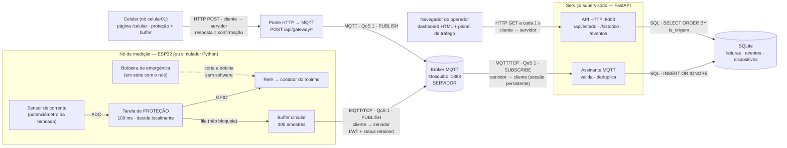
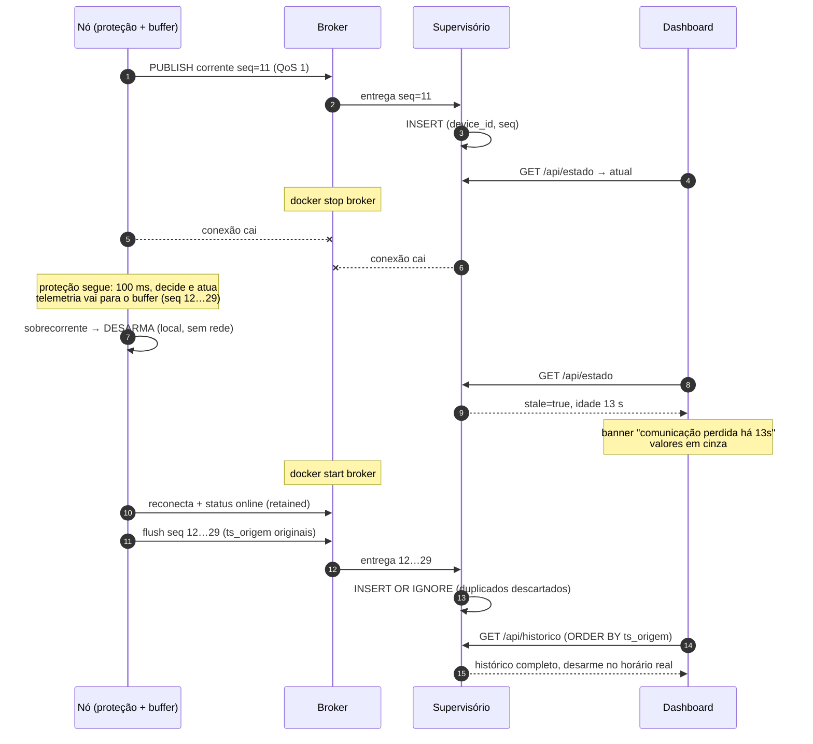

# Arquitetura do fluxo

## Componentes, protocolos e papéis

## Quem é cliente e quem é servidor em cada enlace

| Enlace | Protocolo | Cliente | Servidor | Observação |
|---|---|---|---|---|
| Nó → broker | MQTT 3.1.1 sobre TCP 1883 | nó (`esp32-moinho01` / `sim-moinho01`) | Mosquitto | o nó só **publica**; abre a conexão de saída |
| Backend ↔ broker | MQTT 3.1.1 sobre TCP 1883 | backend (`supervisorio-planta1`) | Mosquitto | o backend **assina** tudo (o broker empurra as mensagens) e **publica** só pela ponte do celular |
| Backend → banco | SQL (biblioteca embutida) | backend | — (SQLite é um arquivo, não um servidor) | escrita pela thread MQTT, leitura pelas rotas HTTP |
| Navegador → backend | HTTP/1.1 sobre TCP 8000 | navegador | backend (uvicorn) | polling de 1 s |
| Celular → backend (ponte) | HTTP/1.1 sobre TCP 8000 | navegador do celular | backend | o backend republica no MQTT com QoS 1 |
| Sensor/botoeira → relé | elétrico | — | — | **fora da rede**: é o caminho de segurança |

No MQTT, publicador e assinante são **os dois clientes**; o único servidor é o broker.
Por isso o nó e o backend não se conhecem e podem cair e voltar de forma independente.

## Sequência de uma falha de comunicação

